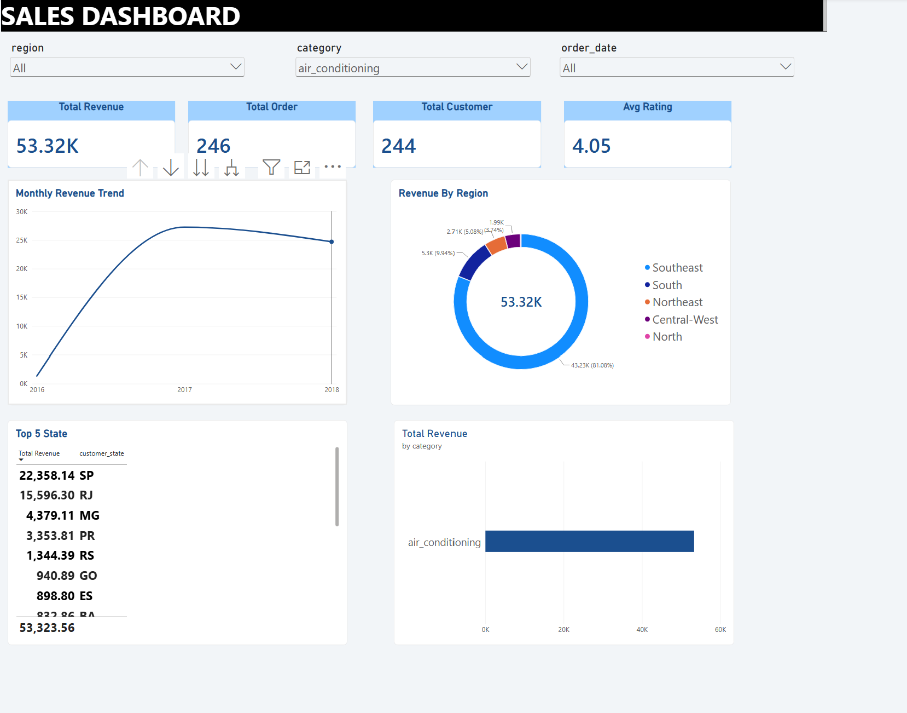

# Sales_Analytics

## E-Commerce Sales & Customer Analytics

### Project Overview

This project is an end-to-end analysis of the Olist Brazilian E-Commerce dataset using SQL and Power BI. The objective is to identify sales trends, product category performance, customer behavior, and state-wise revenue patterns, and to present them in an interactive dashboard.

### Technologies Used

- PostgreSQL
- SQL
- Python (Pandas, SQLAlchemy)
- Power BI
- Git & GitHub
- VS Code

### Project Tasks

1. Data Loading and Inspection
2. Schema Design (Fact and Dimension Tables)
3. Data Cleaning
4. Basic SQL Queries (Filters, GROUP BY, Joins)
5. Advanced SQL Queries (CTEs, Window Functions)
6. Monthly Revenue and Growth Analysis
7. Customer Analysis (Repeat Purchase Rate, Top Customers)
8. Product Category Analysis
9. Business Insights
10. Power BI Dashboard

### Key Findings

- Total Revenue: R$ 13,221,498.11
- Total Orders: 96,478
- Average Order Value: ~R$ 137
- Total Customers: 93,358
- Repeat Purchase Rate: 3.00% (2,801 repeat customers)
- On-time Delivery: 91.9% (8.1% of orders were late)
- Average Delivery Time: 12.5 days
- Average Review Score: 4.09 / 5
- Top Categories by Revenue: health_beauty, watches_gifts, bed_bath_table, sports_leisure, computers_accessories
- Top States by Revenue: SP, RJ, MG, RS, PR

### Dashboard Preview

### Project Structure

- `sql/` – Schema and business queries
- `scripts/` – Python scripts to load data and export for Power BI
- `powerbi/` – Power BI dashboard file
- `reports/` – Query outputs and insights summary
- `screenshots/` – Dashboard images
- `requirements.txt` – Python dependencies
- `README.md` – Project documentation

### Dataset Source

Olist Brazilian E-Commerce Public Dataset:
https://www.kaggle.com/datasets/olistbr/brazilian-ecommerce

### How to Run

1. Clone this repository.
2. Install dependencies using `pip install -r requirements.txt`.
3. Download the dataset from Kaggle and place the CSV files in the `data/` folder.
4. Run `sql/schema/01_schema.sql` in your database to create the tables.
5. Run `scripts/load_data.py` to load the data.
6. Run the queries from the `sql/` folder.
7. Open `powerbi/Olist_Dashboard.pbix` in Power BI Desktop.

### Internship

Inventia Technology Consultants Pvt. Ltd., Noida – Data Analytics Internship

### Conclusion

This project demonstrates practical skills in SQL, data modeling, business analysis, and dashboard creation using Power BI.